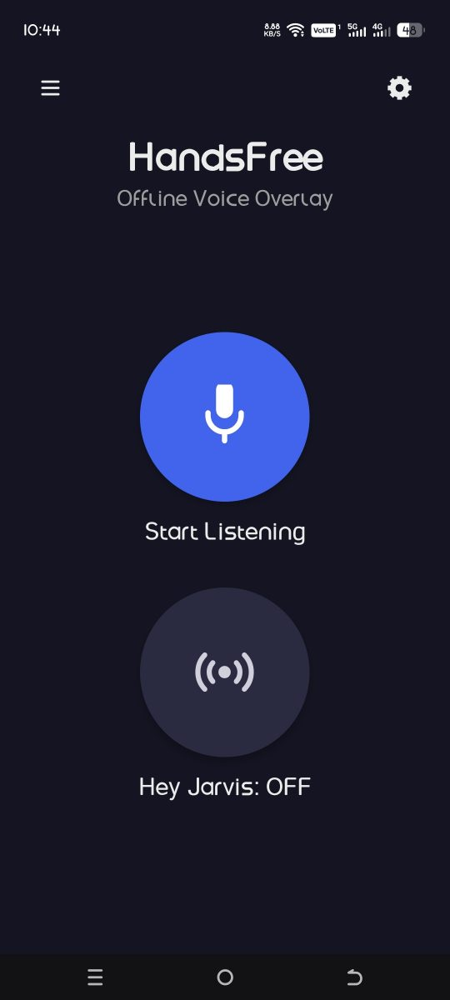
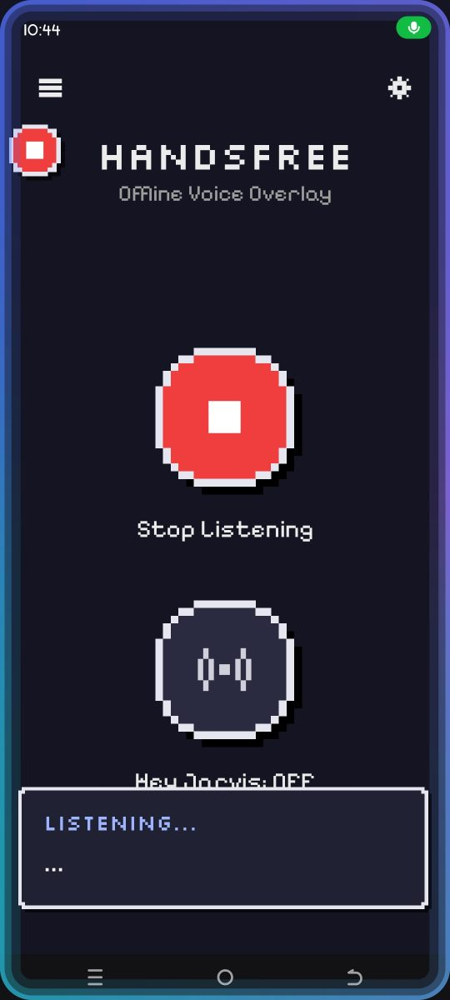
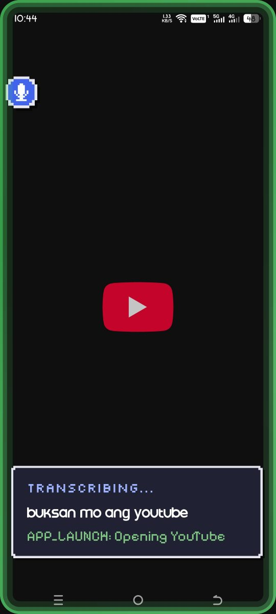

# HandsFree

**An Offline Hands-Free Android App Using Voice Commands in Filipino, English,
and Taglish**

Holy Angel University — School of Computing · Capstone Thesis, 2026

You speak Tagalog, English or Taglish. The app transcribes on-device with a
fine-tuned Whisper-tiny model, normalises the transcript to English through a
hand-maintained lexicon, matches it to a closed intent vocabulary, and executes
it through the Android Accessibility Service. **No network calls, and no LLM in
the command path** — the thesis argues explicitly against probabilistic GUI
agents in assistive technology.

<p align="center">
  
  
  
</p>

```
Mic ─► AudioPreprocessor ─► WhisperOnnxEngine ─► TranslationLayer
                                                        │
        HandsFreeAccessibilityService ◄─ CommandExecutor ◄─ LevenshteinMatcher
```

## Which doc do I read?

| I want to… | Read |
|---|---|
| understand the architecture, rules, and history | **`CLAUDE.md`** — project memory, read first |
| fix commands, add lexicon entries, pick up a task | **`DEV_GUIDE.md`** |
| know what state the build is in right now | **`PROGRESS.md`** |
| write the manuscript / cite the implementation | **`RESEARCH_DOCUMENTATION.md`** |

Superseded docs live in `junk/`.

## Build and run

```bash
./gradlew installDebug
```

Fresh device, in order: grant **Microphone** → grant **Display over other
apps** → Settings → Accessibility → **HandsFree** → On → open the app once and
let the model finish loading. Activate with the navigation-bar accessibility
button or the floating bubble.

Speech model: [KarlShane11/handsfree-whisper-tiny-tl](https://huggingface.co/KarlShane11/handsfree-whisper-tiny-tl)
— whisper-tiny fine-tuned on Filipino/Tagalog, WER 82.72% → 63.15%.

## The models are NOT in this repo — read this before you build

A fresh clone **will not run**. The app reports the missing file in red on the
status card, usually `whisper/encoder.onnx`.

| File | Size | In git? |
|---|---|---|
| `app/src/main/assets/whisper/decoder.onnx` | 109 MB | ❌ **GitHub rejects any file over 100 MB** |
| `app/src/main/assets/whisper/encoder.onnx` | 36 MB | ❌ gitignored with it |
| `app/src/main/assets/whisper/tokens.txt` | 0.8 MB | ❌ gitignored with it |
| `app/src/main/assets/kws/*.onnx` | 3.6 MB | ✅ committed — small enough |

**If you only want to run the app:** you do not need this repo at all. Ask JC
for the built APK (~257 MB) and install it:

```bash
adb install -r app-debug.apk
```

## Get the APK from the Docker image

A ready-built image is published at
[ghcr.io/jcdc0/handsfree](https://github.com/users/JCDC0/packages/container/package/handsfree).
Running it copies the APK into the current folder:

```bash
docker run --rm -v "${PWD}:/out" ghcr.io/jcdc0/handsfree
```

The file `HandsFree-debug.apk` appears in the folder you ran the command from.
The image is built from the `Dockerfile` below (stage `release`).

## Build with Docker

The app runs on an Android phone, not in a container. The Docker image holds the
build environment: JDK 17, Android SDK 35 and the Gradle wrapper. It downloads the
three Whisper files from the
[`models-v1` release](https://github.com/JCDC0/HandsFree/releases/tag/models-v1)
and checks their SHA-256 sums. You need only Docker and this repo.

```bash
git clone https://github.com/JCDC0/HandsFree.git
cd HandsFree
docker build --target apk --output out .
```

The debug APK is written to `out/app-debug.apk`. Install it with
`adb install -r out/app-debug.apk`, or copy it to the phone and open it.
The first build downloads about 2 GB (SDK, Gradle, libraries, models) and takes
10 to 20 minutes. If `app/src/main/assets/whisper/` already holds the three
files, the build uses them instead of downloading.

## Build without Docker

**If you want to build it:** download the three files from the
[`models-v1` release](https://github.com/JCDC0/HandsFree/releases/tag/models-v1)
into `app/src/main/assets/whisper/`. Team members can also copy them from the team Drive, under
`17_Thesis Project/Dataset/onnx_output/`. The release files already have the right
names. **The Drive copies must be renamed as you copy them**, because the exported
names are not the names the app loads:

| In Drive | Copy to `app/src/main/assets/whisper/` |
|---|---|
| `handsfree-tl-encoder.onnx` | `encoder.onnx` |
| `handsfree-tl-decoder.onnx` | `decoder.onnx` |
| `handsfree-tl-tokens.txt` | `tokens.txt` |

`WhisperOnnxEngine` hardcodes those three names (`ENCODER_FILE`, `DECODER_FILE`,
`TOKENS_FILE`). Copy without renaming and the app still reports the file missing.

Set `$drive` / `$DRIVE` to wherever the shared folder is on **your** machine —
the Drive path differs per person — then run one of these from the repo root.

PowerShell:

```powershell
$drive = "G:\.shortcut-targets-by-id\1nv1KJbiCuhapw__nmPCSaVA0OPN8HB-6\17_Thesis Project\Dataset\onnx_output"
$dest = "app\src\main\assets\whisper"
New-Item -ItemType Directory -Force $dest | Out-Null
Copy-Item "$drive\handsfree-tl-encoder.onnx" "$dest\encoder.onnx"
Copy-Item "$drive\handsfree-tl-decoder.onnx" "$dest\decoder.onnx"
Copy-Item "$drive\handsfree-tl-tokens.txt"   "$dest\tokens.txt"
```

Then `./gradlew installDebug`. Do this once; the files stay gitignored and will
not be committed by accident.

Sanity check — `app/src/main/assets/whisper/` should hold exactly three files,
about 36 MB, 109 MB and 0.8 MB. Wrong sizes or wrong names mean a red status
card at runtime, not a build failure.

`onnx_output` also holds `*.int8.onnx` quantised copies (12 MB and 86 MB).
**Do not use those** — nothing in this project has been tested against them.
Trying them is a post-demo experiment, and the APK would shrink by ~48 MB.

Why not Git LFS: it would work, but GitHub's free LFS quota is 1 GB of storage
and 1 GB/month of bandwidth. A 146 MB checkout burns through that in seven
clones, and the deadline is not the moment to discover that.

## Scope

Three demo features: **APP_LAUNCH**, **CALL_ACCEPT**, **NAVIGATION**.
`SMART_SEARCH` works and is not in the demo script. `SCHEDULING` is implemented
but has not been re-tested aloud since its last repair. `MESSAGING` classifies
correctly and deliberately does not execute — see `PROGRESS.md` for why, and for
what a collaborator should pick up next.
